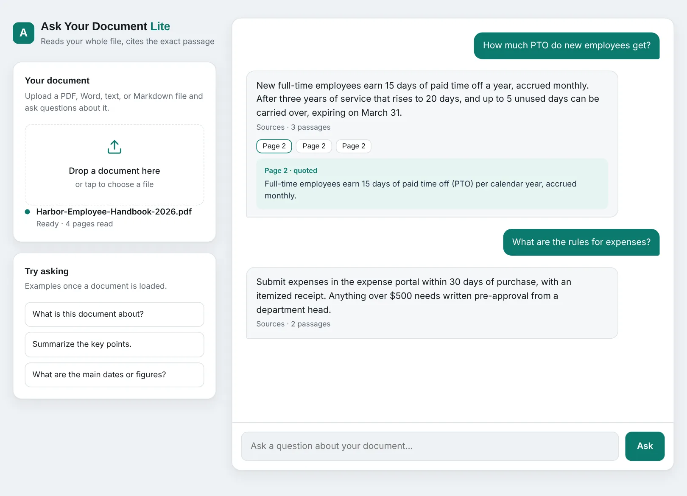
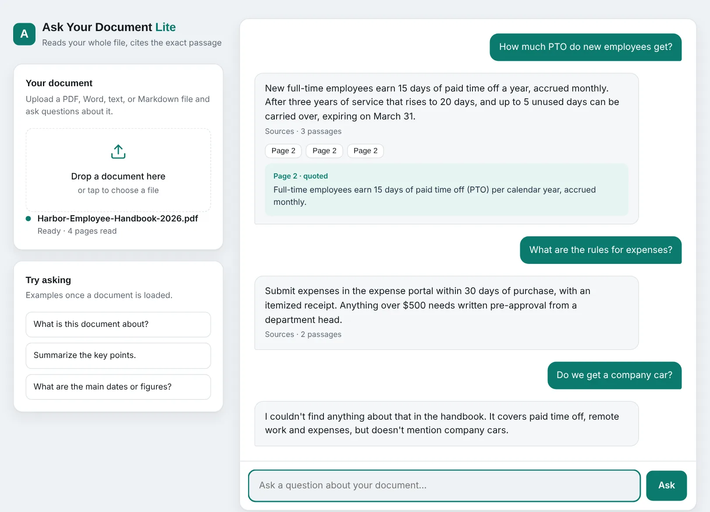
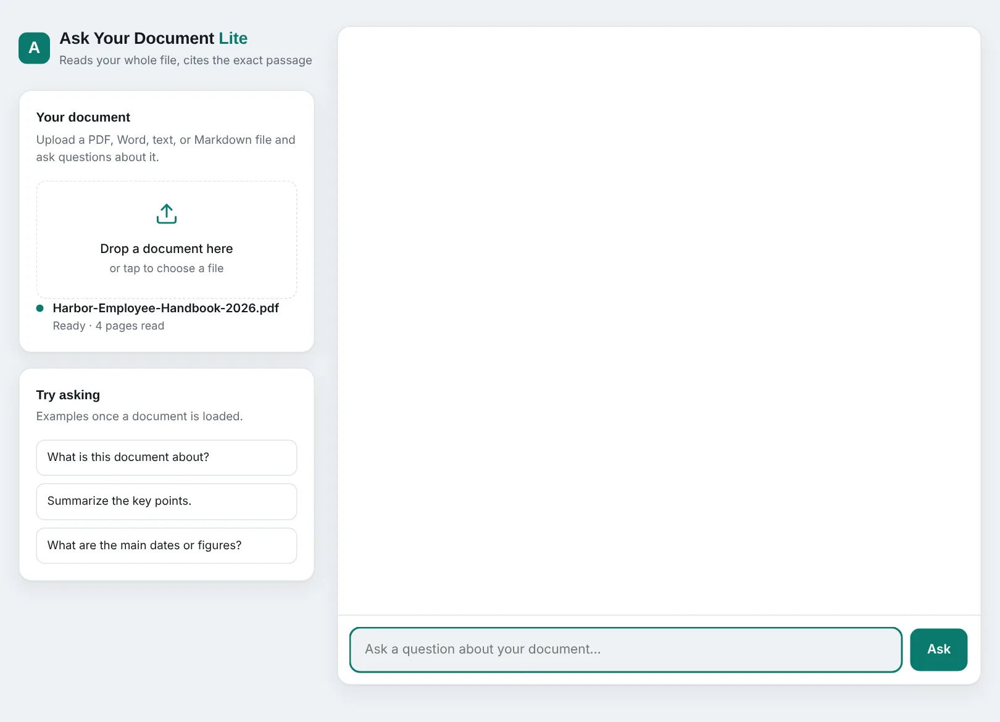

# AskDoc: ask questions of your documents, get answers you can check

Upload a PDF, Word, text or Markdown file and ask questions about it. Every answer
quotes the exact passage and page it came from, and when the document doesn't
cover something the app says so instead of guessing.

**Live demo:** https://aidemo.mcspconsulting.com (also `/hoa` and `/dental` for industry versions)

| Answers with page citations | "Not in this document" instead of a guess | Ready state |
|---|---|---|
|  |  |  |

Built by James McCalla ([MCSP Consulting](https://mcspconsulting.com)).

---

## Two editions in one repo

| | **AskDoc Lite** (live demo) | **AskDoc RAG** (shelved) |
|---|---|---|
| Entry point | `app/main_lite.py` + `app/static/lite.html` | `app/main.py` + `app/static/index.html` |
| How it answers | Sends the whole document to Claude with built-in citations | Local sentence-transformers embeddings, top-k retrieval, then the LLM |
| Limits | ~200 pages per set (`LITE_MAX_CHARS`), up to 5 files (`LITE_MAX_FILES`) | Bigger libraries |
| Image | `Dockerfile.lite` (slim, no torch) | `Dockerfile` (~2 GB with torch) |

Both share `app/extract.py` (PDF/DOCX/text extraction and validation).

## Front end

`app/static/lite.html` is a single dependency-free page (vanilla JS + CSS custom properties):

- Drag-and-drop or tap-to-upload, multi-file, with per-file status and remove
- Chat thread with **citation chips** (page number + quoted passage) under each answer
- Suggested questions once a document is loaded; one-click sample documents
- Industry themes (`/hoa`, `/dental`) that change only the accent tokens, so every page reads as one product
- Clear error states: unsupported file, too many files, document too long, daily limit reached
- Responsive layout that collapses to a single column under 820 px

## Tests

Three plain-Python suites, **47 checks**, each run in CI before its image is built:

| Suite | Checks | Covers |
|---|---|---|
| `test_lite.py` | 30 | citation mapping to file + page, the not-found path, upload validation and limits, **visitor isolation** (a guessed cookie sees nothing), per-visitor and global daily caps, friendly errors with no stack traces |
| `test_api.py` | 12 | HTTP contract of the RAG edition |
| `test_pipeline.py` | 5 | chunking and retrieval plumbing |

```bash
pip install -r requirements-lite.txt reportlab httpx
python test_lite.py && python test_api.py && python test_pipeline.py
```

The Claude call is stubbed, so the tests need no API key.

## Run it locally

```bash
pip install -r requirements-lite.txt
export ANTHROPIC_API_KEY=...        # never committed; see .env.example
uvicorn app.main_lite:app --reload  # http://localhost:8000
```

## Build and deploy

- GitHub Actions (`.github/workflows/build-lite.yml`) runs the tests, then builds and publishes the image to GHCR. Images are never built on a laptop or the server.
- Production runs on a Hetzner VPS under Coolify; the server only pulls the finished image.
- The API key lives only in the host's environment, with its own spending limit.

## Project docs

`docs/MASTER_CANON.md` is the source of truth for decisions and history; `docs/ROADMAP.md` tracks what's next.
